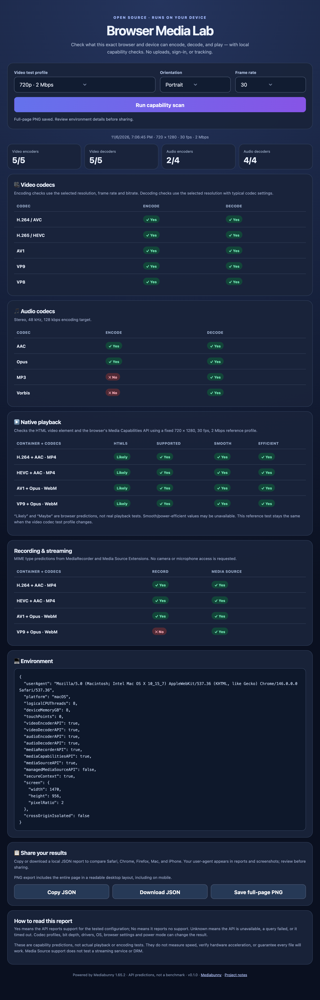

# Browser Media Lab

A free, open-source browser media capability explorer. Find out what your current browser and device report they can encode, decode, play, record, and accept through Media Source Extensions. Runs entirely on a static web server, including GitHub Pages.

No build step, account, API key, analytics, uploads, or runtime CDN requests. All dependencies are included locally.

## Use it

1. Open the hosted page in the browser you want to evaluate.
2. Choose 720p, 1080p, or 4K; portrait or landscape; and 24, 30, or 60 fps.
3. Select **Run capability scan**.
4. Copy or download the JSON report, or select **Save full-page PNG**.

The PNG captures all sections below the viewport, using a desktop layout at least 980 CSS pixels wide so all columns are readable even when exported from a phone. It captures this page's content, not your operating system or other tabs, and needs no screen-sharing permission. Rendering is capped to limit canvas memory use. Browsers may save the image or offer a download preview.

## Example report

A full-page report from Chrome on macOS, using the 720p portrait profile at 30 fps. Results vary by browser and device.

[](docs/browser-media-lab.png)

Open the image for the full-resolution report.

## Run locally

From the project directory:

```sh
python3 -m http.server 8000
```

Open <http://localhost:8000>. Use localhost or HTTPS: some APIs are restricted to secure contexts. Opening `index.html` directly through `file://` is not supported because the app imports an ES module.

## Publish with GitHub Pages

1. Create a public GitHub repository (suggested name: `browser-media-lab`).
2. Put the **contents of this directory** at the repository root and push them to `main`.
3. In **Settings → Pages**, choose **Deploy from a branch**, then `main` and `/ (root)`.
4. Open the URL GitHub provides. Relative asset paths also work under a repository subpath.

There is no build or deployment workflow to configure. `.nojekyll` tells Pages to serve the files directly. The old `browser_media_lab.html` address redirects to the new entry page.

## What is tested

| Area | Mechanism | Configuration |
| --- | --- | --- |
| Video encode | Mediabunny / WebCodecs capability queries | Selected dimensions, frame rate, bitrate |
| Video decode | Mediabunny / WebCodecs capability queries | Selected dimensions; typical codec configuration |
| Audio encode/decode | Mediabunny capability queries | Stereo, 48 kHz; 128 kbps encoding target |
| Native playback | `canPlayType`, `MediaCapabilities.decodingInfo` | Fixed representative MIME strings; 720 × 1280, 30 fps, 2 Mbps video; stereo 48 kHz / 128 kbps audio |
| Recording | `MediaRecorder.isTypeSupported` | Representative container + codec MIME strings |
| Streaming | `MediaSource.isTypeSupported` | The same MIME strings; regular MSE, not ManagedMediaSource |

Video: H.264, HEVC, AV1, VP9, VP8. Audio: AAC, Opus, MP3, Vorbis. Playback / recording / MSE combinations: H.264 + AAC in MP4, HEVC + AAC in MP4, AV1 + Opus in WebM, VP9 + Opus in WebM. Exact MIME strings are preserved in the report.

**These are predictions, not benchmarks or real media tests.** No sample media is encoded, decoded, recorded, or played. A positive answer does not guarantee a particular file works, prove hardware acceleration, or measure speed. Profile, bit depth, codec level, OS, drivers, browser preferences and power state can all matter. Mediabunny's results describe support through its available codec paths; HTML playback can differ.

- **Yes / No:** the query reports support / no support.
- **Unknown:** an API is unavailable, throws, or exceeds the 10-second query timeout. Errors are preserved in JSON. Mediabunny may itself report `false` when its underlying codec API is absent.
- **Likely / Maybe:** the browser's `canPlayType` prediction.
- Summary counts show positive results out of all tested codecs, including Unknowns in the denominator.

Each report includes a schema version, app/dependency versions, timestamp, test profiles, environment, query failures and results. Changing controls after a scan does not change its exports; run again to update them.

## Privacy

The app does not transmit scan results, request camera/microphone access, or persist results. Libraries load from the same host. Your hosting provider still receives normal HTTP requests. Exported JSON and PNG contain your user-agent, platform and basic device/API details; review these before sharing. A PNG is a DOM rendering and may differ slightly from the browser's visual display.

## Development

- `index.html`: UI and entry point
- `styles.css`: responsive layout and print styles
- `app.js`: capability queries, report exports and PNG capture
- `vendor/`: pinned, unmodified third-party distributions and licenses
- `tests/browser.test.mjs`: browser integration checks

Optional integration checks require Node.js 20+, Playwright and its Chromium browser:

```sh
npm install
npx playwright install chromium
npm test
```

To use an installed Chrome instead: `BROWSER_CHANNEL=chrome npm test`. Tests serve a temporary local HTTP server and check actual scans, JSON/PNG downloads, mobile overflow, missing APIs and recovery from dependency failure. Browser support results are intentionally not hard-coded.

Manual release checks: Safari (macOS and iOS), Chrome and Firefox; compare profiles; check export contents; verify all rows appear in a PNG saved from mobile; check clipboard and keyboard navigation. Headless browser results are not representative of a user's everyday browser.

## Dependencies and license

Application code is licensed under [MIT](LICENSE). Included dependencies retain their own licenses:

- [Mediabunny 1.65.2](https://github.com/Vanilagy/mediabunny) — MPL-2.0; bundled code is unmodified. See [third-party notices](THIRD_PARTY_NOTICES.md).
- [html2canvas 1.4.1](https://github.com/niklasvh/html2canvas) — MIT.

See [CONTRIBUTING.md](CONTRIBUTING.md) for changes and bug reports.
